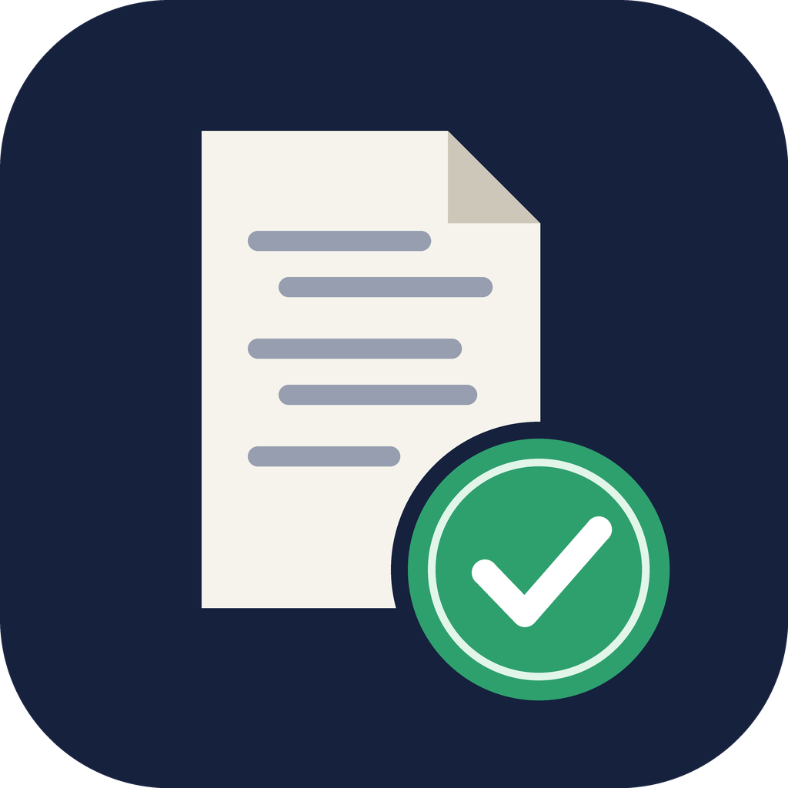

<p align="center">
  
</p>

<h1 align="center">ai-audit-trail</h1>

<p align="center">
  <b>English</b> ·
  <a href="README.zh-TW.md">繁體中文</a> ·
  <a href="README.zh-CN.md">简体中文</a> ·
  <a href="README.ja.md">日本語</a>
</p>

A Claude Code skill and plugin that exports your conversations as a **verifiable audit package** for academic AI-use disclosure.

## Why

More universities, funders, and journals now ask researchers to keep a complete record of how AI was used and to produce it on request. Screenshots and copy-paste don't show that a record is complete or that it hasn't been edited since. This skill packages a conversation as follows:

```
ai-audit-trail_<UTC-time>_<session-prefix>/
├── transcript.pdf   Readable version: cover metadata + every turn (prompts, replies,
│                    reasoning summaries, tool calls and results), all timestamped
├── raw/*.jsonl      Original Claude Code transcripts, untouched (incl. subagents)
├── manifest.json    Model IDs, Claude Code versions, time range, paper info, SHA-256 of each file
├── SHA256SUMS       Hashes of every file in the package
├── SHA256SUMS.tsr   (optional) RFC 3161 trusted timestamp
└── README.txt       Verification instructions for reviewers
```
It also produces a `.zip` of the package with the same name.

## Install

**Option 1: plugin (recommended)**

In Claude Code:
```
/plugin marketplace add Ruxiu0409/ai-audit-trail
/plugin install ai-audit-trail@ai-audit-trail
```

**Option 2: copy the skill manually**

```bash
git clone https://github.com/Ruxiu0409/ai-audit-trail.git
cp -r ai-audit-trail/skills/ai-audit-trail ~/.claude/skills/
```

**Requirements:** Python 3.9+ and [`uv`](https://docs.astral.sh/uv/), which installs `reportlab` automatically. Without `uv`, run `pip install reportlab`.

## Usage

In Claude Code, ask "export this conversation for audit" or run `/ai-audit-trail`. Claude asks for the paper title, section, author, and affiliation (all optional), then builds the package.

You can also run the script directly:

```bash
uv run --with reportlab python skills/ai-audit-trail/scripts/export_audit_trail.py \
  --paper-title "My Paper" --section "Ch. 3 Methods" --author "Jane Doe"
```

| Option | Description |
|---|---|
| `--list` | List all sessions recorded for this project |
| `--session ID` | Export a specific session (repeatable) |
| `--all-project` | Export every session for this project |
| `--transcript PATH` | Export a given JSONL file |
| `--out DIR` | Output directory (default `./ai-audit-trail-exports/`) |
| `--tsa [URL]` | Request an RFC 3161 trusted timestamp. Only the hash is sent (default TSA: FreeTSA) |
| `--max-chars N` | Max characters per block in the PDF (default 20000, `0` = no limit) |
| `--no-thinking` | Leave reasoning summaries out of the PDF |
| `--no-zip` | Don't create a zip |

## Verify

```bash
cd ai-audit-trail_xxx/
shasum -a 256 -c SHA256SUMS     # every file prints OK = identical to when it was archived
# only if a timestamp was requested:
openssl ts -verify -data SHA256SUMS -in SHA256SUMS.tsr -CAfile cacert.pem
```

## Caveats

- **Privacy:** `raw/` contains full system messages, file paths, account email, and the contents of files the AI read. Review it before sharing.
- **Retention:** Claude Code deletes transcripts older than `cleanupPeriodDays` (30 by default). For long-running research, raise that setting or export regularly.
- **Scope:** Claude Code conversations only. For claude.ai, use its built-in data export.
- **Legal standing:** This tool gives a technical proof of integrity. Whether it's accepted is up to your institution or journal.

## License

[MIT](LICENSE)
