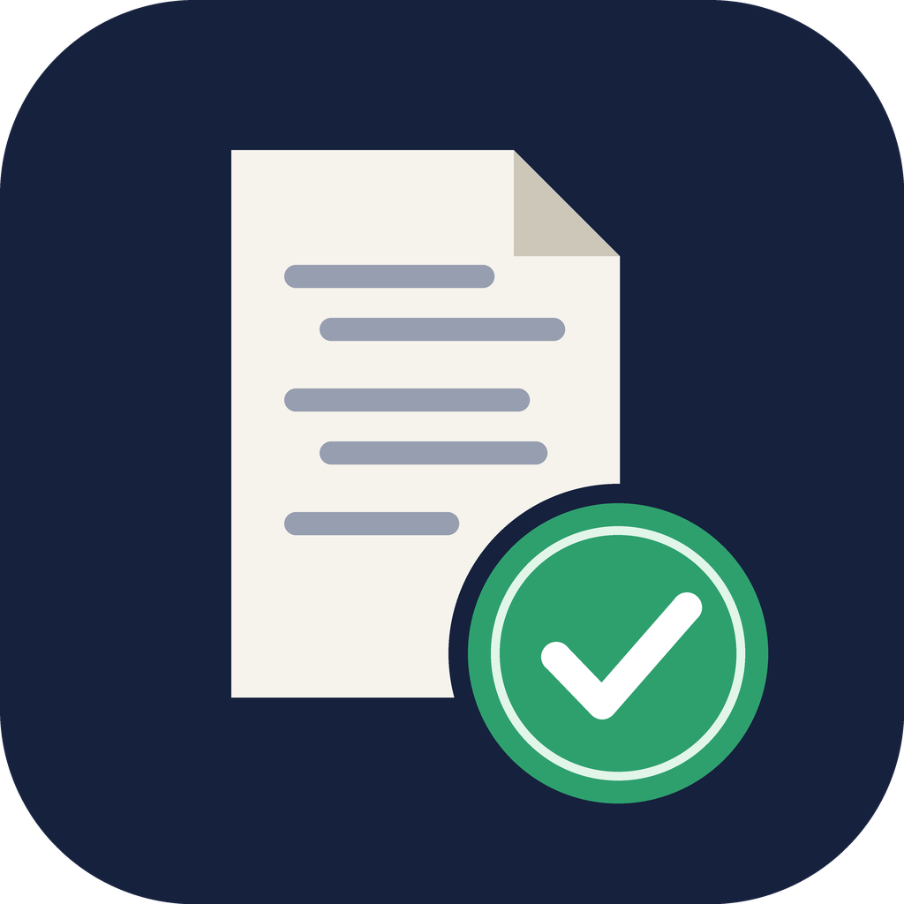

<p align="center">
  
</p>

<h1 align="center">ai-audit-trail</h1>

<p align="center">
  <a href="README.md">English</a> ·
  <a href="README.zh-TW.md">繁體中文</a> ·
  <b>简体中文</b> ·
  <a href="README.ja.md">日本語</a>
</p>

把 Claude Code 的 AI 协作对话导出为**可验证的审计归档包**，供学术机构、期刊或审稿人备查。

## 为什么需要

越来越多的学术机构和期刊要求研究者保留 AI 协作的完整记录，并在需要时提供。仅靠截图或复制粘贴，很难证明记录是完整的，也很难证明内容没有被事后修改。这个 Skill 会把对话打包成：

```
ai-audit-trail_<UTC时间>_<session前8位>/
├── transcript.pdf   可读版：封面元数据＋逐条对话（提问、回复、推理摘要、工具调用与结果）
├── transcripts/     已脱敏的 Claude Code 记录 JSONL（含子代理记录）
├── manifest.json    模型、Claude Code 版本、起止时间、论文信息、脱敏统计、各文件脱敏前后的 SHA-256
├── SHA256SUMS       所有文件的哈希值
├── SHA256SUMS.tsr   （可选）RFC 3161 第三方可信时间戳
└── README.txt       给审稿人的验证说明
```
另外会生成同名的 `.zip`，以及一个独立的 `….PRIVATE/` 文件夹，里面是未脱敏的原始文件。该文件夹仅供你自己保存，不会被打包进 zip。

## 默认保护个人信息

可提交的归档包会删除系统消息、对个人信息脱敏，但保留对话内容和 **AI 读取过的文件内容**：

| | 内容 |
|---|---|
| **删除** | 系统提示词、环境／账号／组织信息、`<system-reminder>` 区块、内部遥测字段 |
| **替换为 `[REDACTED:类别]`** | 邮箱、主目录路径中的用户名、git 姓名与邮箱、主机名、账号／组织 UUID、API 密钥／token／密码／私钥、台湾身份证号、电话、公网 IP，以及你用 `--redact-term` 指定的词（例如真实姓名、学号） |
| **保留** | 提问、回复、推理摘要、工具调用与结果、AI 读取的文件内容、附件、时间戳、模型 ID |

导出后，Claude 还会检查脱敏版本中是否有规则无法识别的个人信息（例如普通句子里的人名），如有会建议你添加脱敏词后重新导出。`manifest.json` 同时记录脱敏版和未脱敏原始文件的 SHA-256。脱敏结果是确定性的，因此必要时可以证明脱敏版确实来自你保存的原始文件。

## 安装

**方法一：通过 plugin 安装（推荐）**

在 Claude Code 中运行：
```
/plugin marketplace add Ruxiu0409/ai-audit-trail
/plugin install ai-audit-trail@ai-audit-trail
```

**方法二：手动复制 Skill**

```bash
git clone https://github.com/Ruxiu0409/ai-audit-trail.git
cp -r ai-audit-trail/skills/ai-audit-trail ~/.claude/skills/
```

**依赖**：Python 3.9 及以上，以及 [`uv`](https://docs.astral.sh/uv/)（会自动安装 `reportlab`）。没有 `uv` 的话，运行 `pip install reportlab` 也可以。

## 使用

在 Claude Code 对话中说“帮我备份这次对话”或“导出 AI 协作记录”，或者直接输入 `/ai-audit-trail`。Claude 会先询问论文标题、章节、作者等信息（都可以跳过），再生成归档包。

也可以直接运行脚本：

```bash
uv run --with reportlab python skills/ai-audit-trail/scripts/export_audit_trail.py \
  --paper-title "我的论文" --section "第三章 方法" --author "王小明"
```

| 选项 | 说明 |
|---|---|
| `--list` | 列出本项目的所有对话 |
| `--session ID` | 导出指定对话（可重复使用） |
| `--all-project` | 导出本项目的所有对话 |
| `--transcript PATH` | 直接指定一个 JSONL 文件 |
| `--out DIR` | 输出目录（默认 `./ai-audit-trail-exports/`） |
| `--tsa [URL]` | 申请 RFC 3161 可信时间戳，只发送哈希值（默认使用 FreeTSA） |
| `--max-chars N` | PDF 中每个区块的字数上限，默认 20000，`0` 表示不截断 |
| `--no-thinking` | PDF 中不包含推理摘要 |
| `--no-zip` | 不生成 zip |
| `--redact-term 词` | 额外需要脱敏的词（可重复使用） |
| `--no-redact` | 归档包中放入未脱敏的原始文件 |
| `--no-private-copy` | 不在 `.PRIVATE/` 中保存未脱敏的原始文件 |

## 验证

```bash
cd ai-audit-trail_xxx/
shasum -a 256 -c SHA256SUMS     # 每个文件都显示 OK，表示与归档时完全一致
# 仅在申请了时间戳时需要：
openssl ts -verify -data SHA256SUMS -in SHA256SUMS.tsr -CAfile cacert.pem
```

## 注意事项

- **隐私**：脱敏依靠规则匹配加 AI 复查，提交前请自己再检查一遍。图片和截图不会被脱敏。切勿提交 `.PRIVATE/` 文件夹。
- **保留期限**：Claude Code 默认会删除 30 天以前的对话记录（配置项 `cleanupPeriodDays`）。长期研究建议调大该值，或定期导出。
- **适用范围**：仅支持 Claude Code 的对话。claude.ai 网页版请使用网页内置的数据导出功能。
- **法律效力**：本工具提供技术层面的完整性证明，但不代表任何机构一定会认可。请以你所在机构或期刊的规定为准。

## 许可证

[MIT](LICENSE)
