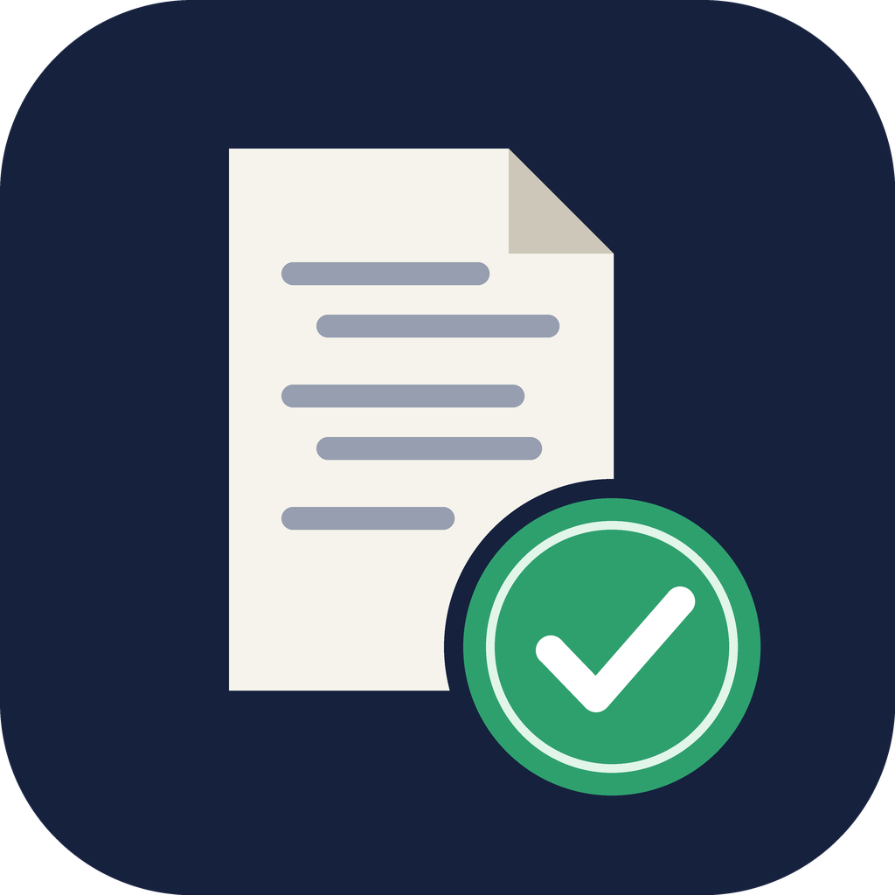

<p align="center">
  
</p>

<h1 align="center">ai-audit-trail</h1>

<p align="center">
  <a href="README.md">English</a> ·
  <b>繁體中文</b> ·
  <a href="README.zh-CN.md">简体中文</a> ·
  <a href="README.ja.md">日本語</a>
</p>

把 Claude Code 的 AI 協作對話匯出成**可驗證的稽核封存包**，供學術單位、期刊或審查委員備查。

## 為什麼需要

越來越多學術單位和期刊要求研究者保留 AI 協作的完整紀錄，必要時提供備查。單純截圖或複製貼上，很難證明紀錄完整，也很難證明內容沒有被事後改過。這個 Skill 會把對話打包成：

```
ai-audit-trail_<UTC時間>_<session前8碼>/
├── transcript.pdf   可讀版：封面詮釋資料＋逐則對話（提問、回覆、推理摘要、工具呼叫與結果）
├── transcripts/     已遮蔽個資的 Claude Code 紀錄 JSONL（含子代理紀錄）
├── manifest.json    模型、Claude Code 版本、起訖時間、論文資訊、遮蔽統計、各檔遮蔽前後的 SHA-256
├── SHA256SUMS       全部檔案雜湊值
├── SHA256SUMS.tsr   （選用）RFC 3161 第三方可信時間戳
└── README.txt       給審查者的驗證說明
```
另外會產生同名的 `.zip`，以及一個獨立的 `….PRIVATE/` 資料夾，裡面是未遮蔽的原始檔。這個資料夾只給你自己保存，不會被打包進 zip。

## 預設保護個資

可提交的封存包會移除系統訊息、遮蔽個人資料，但保留對話內容和 **AI 讀過的檔案內容**：

| | 內容 |
|---|---|
| **移除** | 系統提示詞、環境／帳號／組織資訊、`<system-reminder>` 區塊、內部遙測欄位 |
| **遮蔽成 `[REDACTED:類別]`** | email、家目錄路徑裡的使用者名稱、git 姓名與 email、主機名稱、帳號／組織 UUID、API 金鑰／token／密碼／私鑰、身分證字號、電話、公開 IP，以及你用 `--redact-term` 指定的字詞（例如真實姓名、學號） |
| **保留** | 提問、回覆、推理摘要、工具呼叫與結果、AI 讀過的檔案內容、附加檔案、時間戳、模型 ID |

匯出後，Claude 還會檢查遮蔽版裡有沒有規則抓不到的個資（例如一般句子裡的人名），有的話會建議你加上遮蔽字詞重新匯出。`manifest.json` 同時記錄遮蔽版和未遮蔽原始檔的 SHA-256。遮蔽結果是確定性的，所以必要時可以證明遮蔽版確實來自你保存的原始檔。

## 安裝

**方法一：用 plugin 安裝（建議）**

在 Claude Code 裡執行：
```
/plugin marketplace add Ruxiu0409/ai-audit-trail
/plugin install ai-audit-trail@ai-audit-trail
```

**方法二：手動複製 Skill**

```bash
git clone https://github.com/Ruxiu0409/ai-audit-trail.git
cp -r ai-audit-trail/skills/ai-audit-trail ~/.claude/skills/
```

**需求**：Python 3.9 以上，以及 [`uv`](https://docs.astral.sh/uv/)（會自動安裝 `reportlab`）。沒有 `uv` 的話，執行 `pip install reportlab` 也可以。

## 使用

在 Claude Code 對話中說「幫我備份這次對話」或「匯出 AI 協作紀錄」，或者直接輸入 `/ai-audit-trail`。Claude 會先問你論文名稱、章節、作者等資訊（都可以略過），再產生封存包。

也可以直接執行腳本：

```bash
uv run --with reportlab python skills/ai-audit-trail/scripts/export_audit_trail.py \
  --paper-title "我的論文" --section "第三章 方法" --author "王小明"
```

| 選項 | 說明 |
|---|---|
| `--list` | 列出這個專案的所有對話 |
| `--session ID` | 匯出指定的對話（可以重複使用） |
| `--all-project` | 匯出這個專案的所有對話 |
| `--transcript PATH` | 直接指定一個 JSONL 檔 |
| `--out DIR` | 輸出位置（預設 `./ai-audit-trail-exports/`） |
| `--tsa [URL]` | 申請 RFC 3161 可信時間戳，只送出雜湊值（預設用 FreeTSA） |
| `--max-chars N` | PDF 中每個區塊的字數上限，預設 20000，`0` 表示不截斷 |
| `--no-thinking` | PDF 不放推理摘要 |
| `--no-zip` | 不產生 zip |
| `--redact-term 字詞` | 額外要遮蔽的字詞（可以重複使用） |
| `--no-redact` | 封存包裡放未遮蔽的原始檔 |
| `--no-private-copy` | 不在 `.PRIVATE/` 保存未遮蔽的原始檔 |

## 驗證

```bash
cd ai-audit-trail_xxx/
shasum -a 256 -c SHA256SUMS     # 每個檔案都顯示 OK，代表與封存當下一致
# 有申請時間戳時才需要：
openssl ts -verify -data SHA256SUMS -in SHA256SUMS.tsr -CAfile cacert.pem
```

## 注意

- **隱私**：遮蔽靠規則比對加上 AI 複查，提交前請自己再看一次。圖片和截圖不會被遮蔽。`.PRIVATE/` 資料夾絕對不要提交。
- **保存期限**：Claude Code 預設會刪除 30 天以前的對話紀錄（設定項 `cleanupPeriodDays`）。長期研究建議把它調大，或定期匯出。
- **適用範圍**：只支援 Claude Code 的對話。claude.ai 網頁版請用網頁內建的資料匯出功能。
- **法律效力**：這個工具提供技術上的完整性證明，但不代表任何單位一定會採認。請以你所屬單位或期刊的規定為準。

## 授權

[MIT](LICENSE)
